# MedAgenda

Sistema de agendamento de consultas médicas, feito como projeto de portfólio. Pacientes marcam e cancelam consultas, médicos acompanham a agenda e registram o atendimento, e a recepção administra o cadastro e confirma a chegada dos pacientes.

O projeto combina uma aplicação moderna (Angular + API REST com JWT) com um módulo administrativo legado (JSP/JSTL com sessão) dentro do mesmo backend, o que mostra dois jeitos de autenticar e proteger uma aplicação Spring.

## Sumário

- [Telas](#telas)
- [Stack](#stack)
- [Arquitetura](#arquitetura)
- [Perfis e permissões](#perfis-e-permissões)
- [Regras de negócio](#regras-de-negócio)
- [Como rodar](#como-rodar)
- [Usuários de teste](#usuários-de-teste)
- [Testes](#testes)
- [API](#api)
- [Estrutura do repositório](#estrutura-do-repositório)
- [Decisões técnicas](#decisões-técnicas)
- [Status do projeto](#status-do-projeto)

## Telas

O Angular tem modo claro e escuro (botão no menu lateral); a recepção usa o módulo JSP.

| Login (modo claro) | Login (modo escuro) |
|---|---|
| 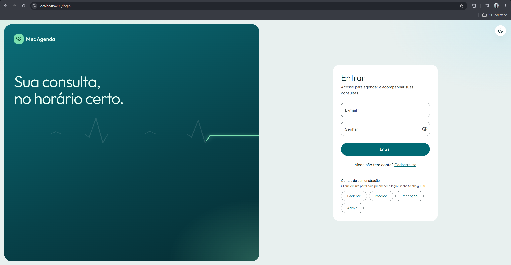 | 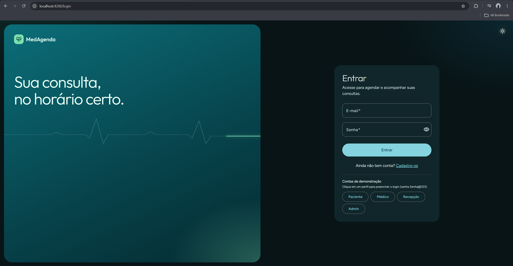 |

| Início do paciente (claro) | Início do paciente (escuro) |
|---|---|
| 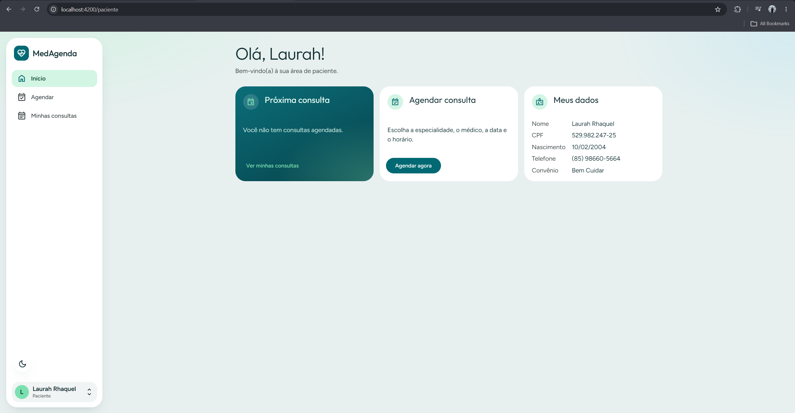 | 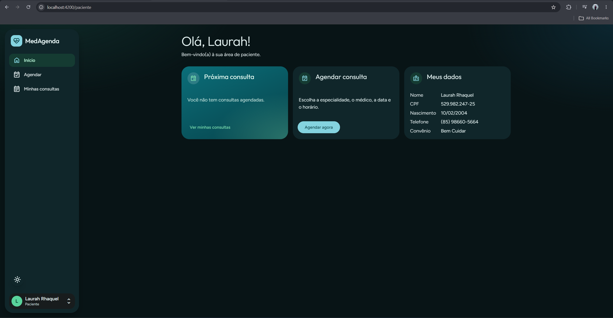 |

Agendamento em etapas (especialidade, médico, data, horário e confirmação):

| Médico (busca por nome) | Data (só dias de atendimento) |
|---|---|
| 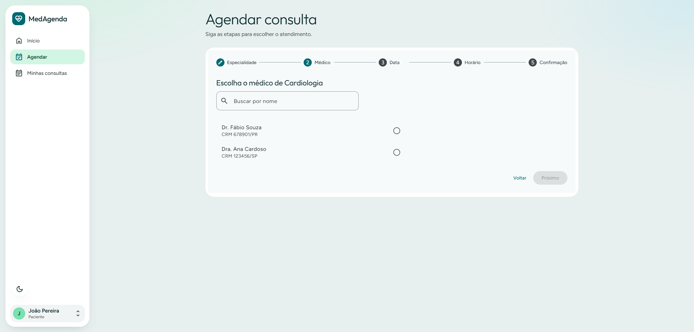 | 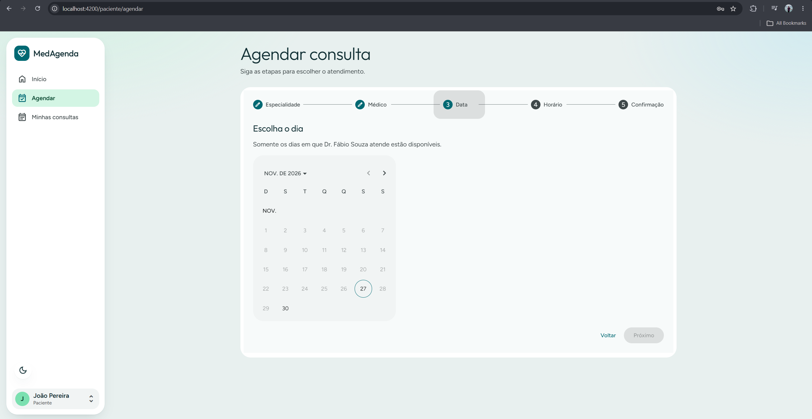 |

| Horários livres | Confirmação |
|---|---|
| 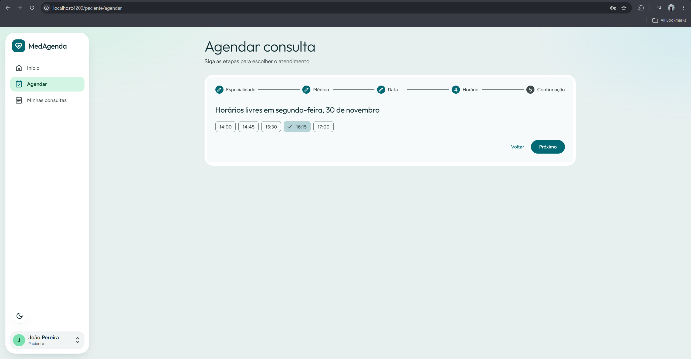 | 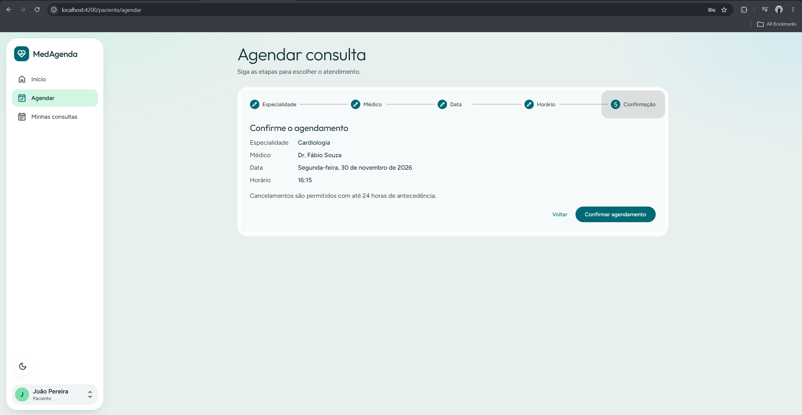 |

| Minhas consultas | Histórico |
|---|---|
| 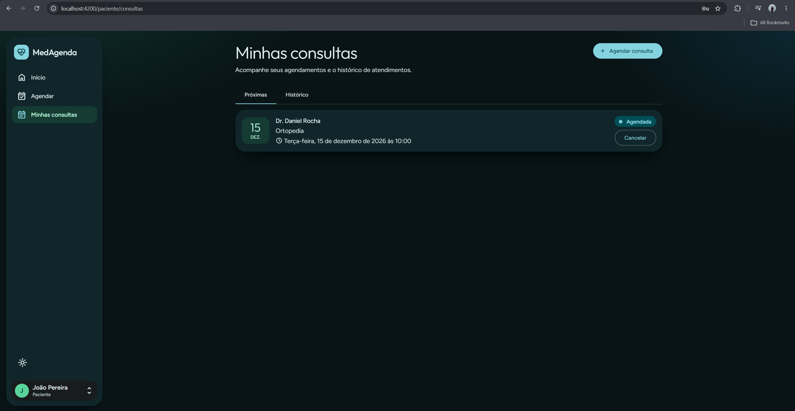 | 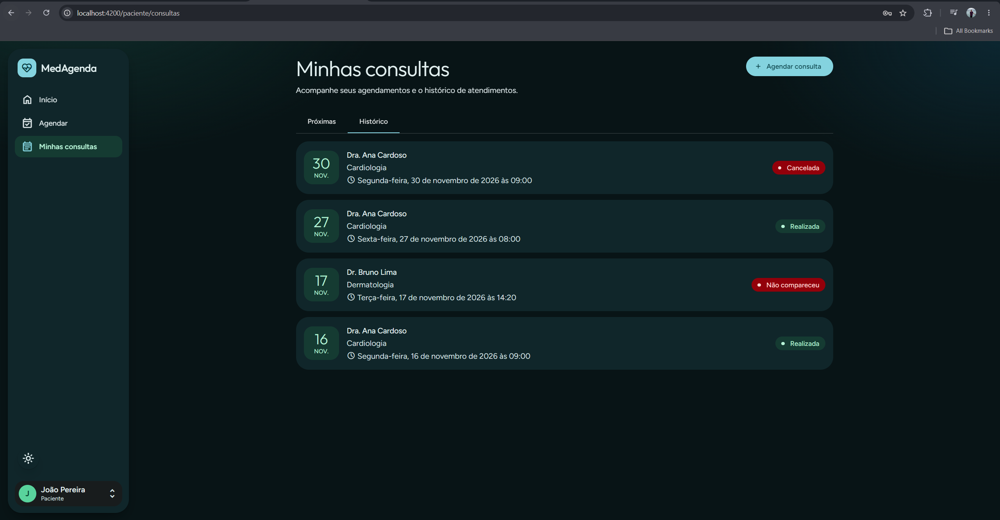 |

Área do médico:

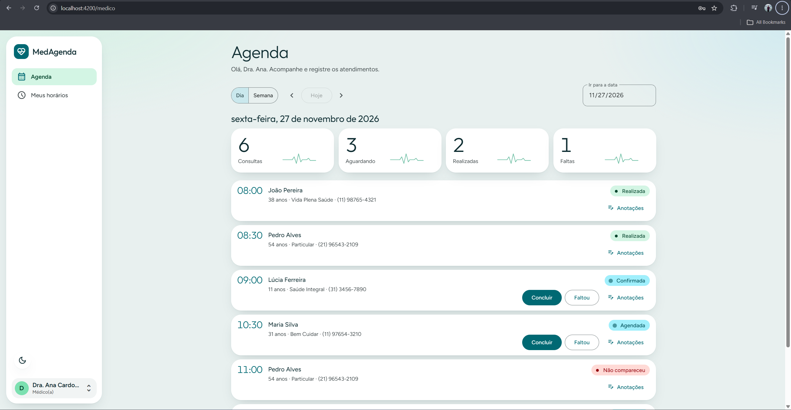

Recepção (módulo JSP):

| Consultas do dia | Relatório |
|---|---|
| 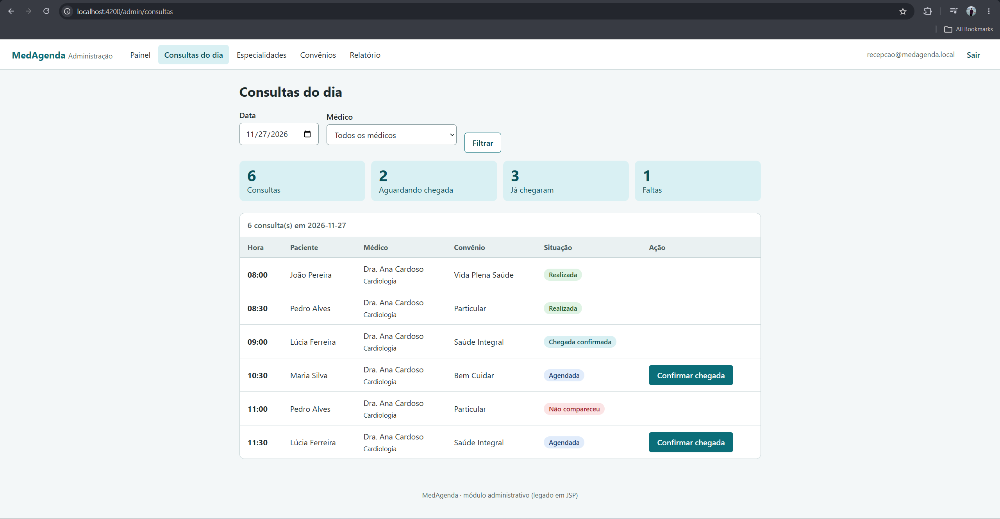 | 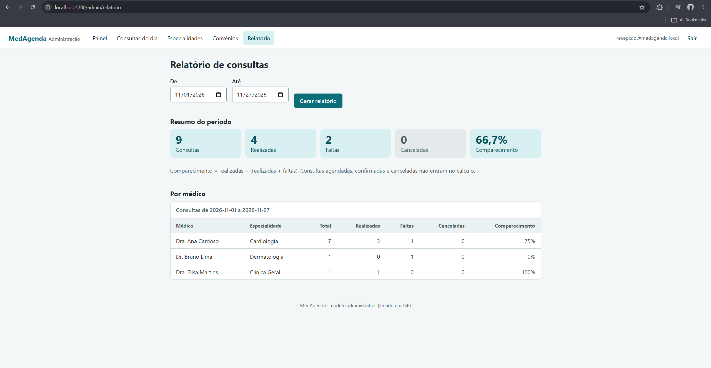 |

Versão para celular (o menu lateral vira uma barra no topo):

| Início do paciente | Minhas consultas | Agenda do médico | Horários do médico |
|---|---|---|---|
|  | 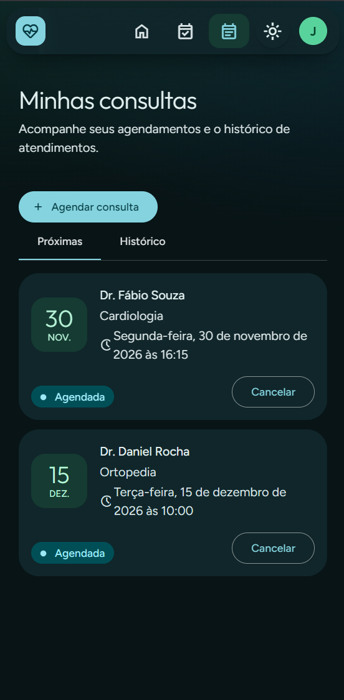 | 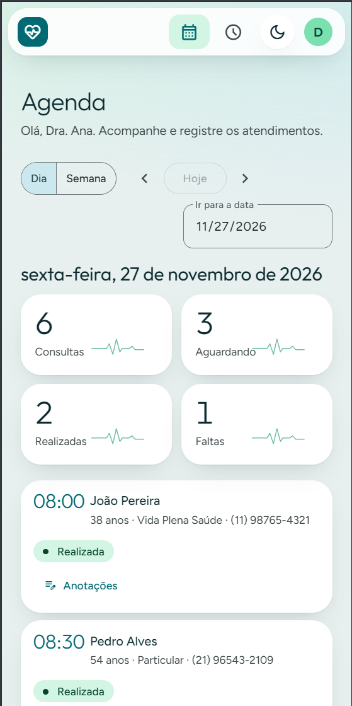 | 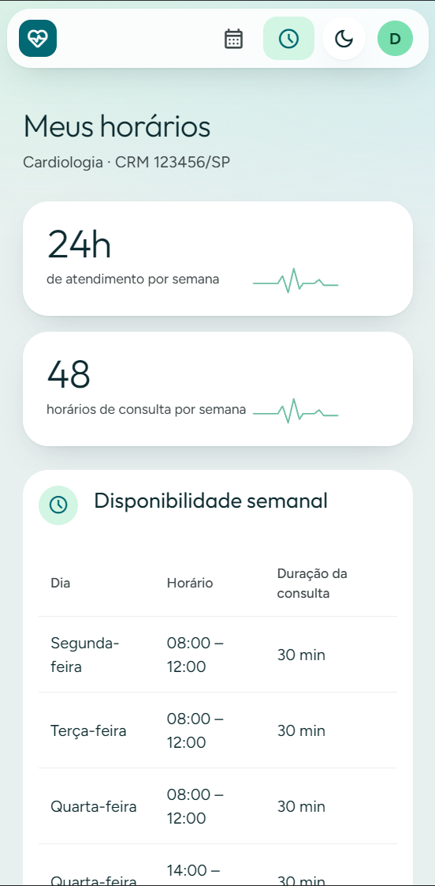 |

## Stack

| Camada | Tecnologias |
|---|---|
| Frontend | Angular 22 (standalone, Signals, zoneless, `@if`/`@for`), RxJS, rotas lazy com guards, formulários reativos tipados, SCSS, Angular Material com tema próprio (paleta hospitalar, modo claro/escuro, fontes Outfit e Figtree locais) |
| Backend | Java 25, Spring Boot 4.2, Spring Security (JWT e sessão), Spring Data JPA/Hibernate, Flyway, OpenAPI (springdoc) |
| Módulo legado | JSP + JSTL no mesmo backend (pacote WAR executável) |
| Banco | PostgreSQL (com extensão `unaccent`) |
| Testes | JUnit 5 + Mockito + AssertJ, MockMvc, Vitest, Playwright |

## Arquitetura

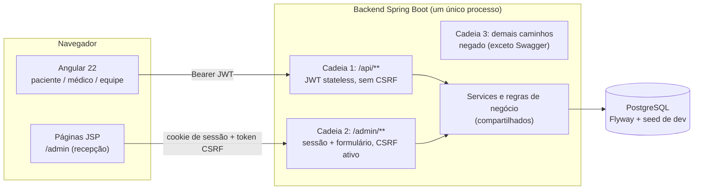

Pontos centrais:

- **Duas formas de autenticar, uma camada de negócio.** A API REST (`/api/**`) é stateless, usa JWT no cabeçalho `Authorization` e não precisa de CSRF. O módulo `/admin/**` usa sessão por cookie, e por isso mantém o CSRF ligado. Os dois chamam os mesmos *services*, então as regras não são duplicadas.
- **Regras no domínio.** Regras que dependem só da própria consulta (cancelamento com 24 h, confirmação de chegada, registro de atendimento) ficam na entidade `Appointment`. As que dependem de outros dados (disponibilidade, conflitos) ficam no `AppointmentService`.
- **Banco como última barreira.** Índices únicos parciais impedem dois agendamentos ativos no mesmo horário, mesmo se duas requisições passarem pelas verificações ao mesmo tempo.

## Perfis e permissões

| Perfil | O que faz |
|---|---|
| **Paciente** | Agenda, lista e cancela as próprias consultas; vê o histórico |
| **Médico** | Vê a agenda diária e semanal, gerencia os próprios horários de atendimento, conclui consultas, registra faltas e anotações clínicas |
| **Recepção** | Agenda para um paciente, cancela consultas, confirma a chegada, usa o módulo `/admin` e consulta cadastros |
| **Administrador** | Tudo da recepção, mais cadastro e exclusão de médicos |

Os guards do Angular são só experiência de uso. A autorização real é refeita no backend a cada requisição (`@PreAuthorize` em cada endpoint).

## Regras de negócio

- Não existe consulta duplicada: o mesmo **médico** e o mesmo **paciente** não podem ter duas consultas ativas no mesmo horário.
- Só é possível agendar **dentro da disponibilidade do médico**, em horários da grade (por exemplo, 09:00 e 09:30, nunca 09:10).
- Só datas **futuras**, com no máximo **90 dias** de antecedência.
- O cancelamento exige no mínimo **24 horas** de antecedência.
- A confirmação de chegada só vale para consultas **agendadas** e **no dia** da consulta.
- O atendimento só pode ser registrado a partir do horário da consulta.
- Existe um endpoint de **horários livres** de um médico em uma data.
- Convênio ou especialidade com vínculos (pacientes ou médicos) não pode ser excluído; nomes não se repetem, sem diferenciar maiúsculas e acentos.
- O horário "agora" sempre vem de um `Clock` fixado no fuso da clínica (`America/Sao_Paulo`), independente do fuso do servidor.

## Como rodar

### Pré-requisitos

- Java 25 (por exemplo, `winget install EclipseAdoptium.Temurin.25.JDK`)
- Node.js com npm
- PostgreSQL com um banco e usuário `medagenda` (senha `medagenda`)
- Git

Por padrão a aplicação usa `jdbc:postgresql://localhost:5432/medagenda`. Para outro banco, defina `DB_URL`, `DB_USERNAME` e `DB_PASSWORD`.

### 1. Backend

```bash
cd backend
./mvnw spring-boot:run
```

Espere a mensagem `Started MedAgendaApplication`. O Flyway cria o esquema e, no perfil `dev` (o padrão local), carrega os dados de exemplo. A API fica em `http://localhost:8080`.

### 2. Frontend

Em outro terminal:

```bash
cd frontend
npm install
npm start
```

O app abre em `http://localhost:4200`. O servidor de desenvolvimento encaminha `/api` e `/admin` para o backend (`proxy.conf.json`), então não há problema de CORS.

### Endereços úteis

| O quê | URL |
|---|---|
| Aplicação Angular | http://localhost:4200 |
| Módulo administrativo (JSP) | http://localhost:8080/admin |
| Swagger / OpenAPI | http://localhost:8080/swagger-ui.html |

O primeiro acesso a cada página do `/admin` leva alguns segundos, porque o servidor compila a JSP na primeira vez.

### Variáveis de ambiente

| Variável | Para que serve | Padrão |
|---|---|---|
| `DB_URL`, `DB_USERNAME`, `DB_PASSWORD` | Conexão com o PostgreSQL | banco local `medagenda` |
| `JWT_SECRET` | Chave HS256 em Base64 (mínimo 256 bits). **Obrigatória fora do perfil `dev`**: a aplicação se recusa a subir sem ela | chave de desenvolvimento, só no `dev` |
| `JWT_EXPIRATION` | Validade do token (formato ISO-8601) | `PT2H` |
| `CORS_ALLOWED_ORIGINS` | Origens permitidas na API | `http://localhost:4200` |
| `SESSION_COOKIE_SECURE` | Marca o cookie de sessão do `/admin` como `Secure` (use `true` com HTTPS) | `false` |
| `SPRING_PROFILES_ACTIVE` | Perfil ativo. `dev` carrega os dados de exemplo | `dev` |

## Usuários de teste

A senha de todos é `Senha@123`. Existem só no perfil `dev`.

| Perfil | E-mail |
|---|---|
| Administrador | `admin@medagenda.local` |
| Recepção | `recepcao@medagenda.local` |
| Médico | `medico@medagenda.local` |
| Paciente | `paciente@medagenda.local` ou `maria.silva@medagenda.local` |

A tela de login do Angular tem botões de acesso rápido por perfil. O login do `/admin` é separado: aceita só recepção e administrador.

## Testes

| Camada | Comando | Pré-requisito |
|---|---|---|
| Backend (unitário e integração) | `cd backend && ./mvnw test` | PostgreSQL no ar com o seed de dev |
| Frontend (Vitest) | `cd frontend && npm test` | nenhum |
| E2E (Playwright) | `cd e2e && npm install && npx playwright install chromium && npx playwright test` | backend rodando |

O que cada camada cobre:

- **Backend, unitário.** Regras da entidade `Appointment`, cálculo de horários (`SlotSchedule`), busca sem acento e todas as regras de agendamento e cancelamento do `AppointmentService` com `Clock` fixo.
- **Backend, integração.** Matriz de segurança das três cadeias (API, `/admin`, caminhos fechados), CSRF, papéis por endpoint, bloqueio de ordenação por campos sensíveis, e os índices únicos que evitam agendamento duplicado, rodando contra o PostgreSQL real. Os testes de persistência usam transação com rollback, então o seed não muda.
- **Frontend.** `AuthService`, interceptor, guards, validadores (CPF, telefone), funções de data e tratamento de erros da API.
- **E2E.** Login por perfil, redirecionamento e volta à página pedida, agendamento e cancelamento pela interface, conflito de horário (409) e o módulo `/admin`. Os cenários desfazem o que criam, então podem rodar várias vezes no mesmo banco.

Os testes E2E sobem o `npm start` do frontend sozinhos, ou reaproveitam um servidor já aberto.

## API

A documentação completa e interativa está no Swagger (`/swagger-ui.html`). Resumo dos grupos:

| Grupo | Endpoints principais |
|---|---|
| Autenticação | `POST /api/auth/login`, `POST /api/auth/register`, `GET /api/auth/me` |
| Especialidades e convênios | CRUD em `/api/specialties` e `/api/health-insurances` (leitura pública, escrita só da equipe) |
| Médicos | CRUD em `/api/doctors` (escrita só do administrador); horários em `/api/doctors/{id}/availabilities` |
| Pacientes | CRUD em `/api/patients` |
| Agendamento | `GET /api/doctors/{id}/free-slots?date=`, `POST /api/appointments`, `GET /api/appointments/me`, `PATCH /api/appointments/{id}/cancel` |
| Agenda do médico | `GET /api/doctors/{id}/appointments`, `PATCH /api/appointments/{id}/complete`, `.../no-show`, `PUT .../notes` |

Convenções:

- Listagens são **paginadas** (`page`, `size`, `sort`). A ordenação só aceita campos de uma lista permitida.
- Erros seguem o formato **Problem Details** (RFC 9457), com a lista de campos inválidos em erros de validação.
- Datas e horas são **locais da clínica**, sem fuso (`2026-12-07T09:00:00`).

## Estrutura do repositório

```
.
├── backend/            API Spring Boot + módulo JSP
│   ├── src/main/java/com/medagenda/
│   │   ├── auth/         login, JWT, perfis e configuração de segurança
│   │   ├── scheduling/   consultas, horários livres, agenda do médico
│   │   ├── doctor/ patient/ specialty/ insurance/
│   │   ├── admin/        controllers e serviços do módulo JSP
│   │   └── common/       erros globais, paginação, utilitários
│   ├── src/main/resources/db/   migrations (Flyway) e seed de dev
│   ├── src/main/webapp/WEB-INF/ JSPs e tag files
│   └── src/test/
├── frontend/           Angular 22
│   └── src/app/
│       ├── core/         auth, interceptor, layout, notificações
│       ├── shared/       validadores, datas, pipes, componentes comuns
│       └── features/     auth, patient, doctor, staff
└── e2e/                testes Playwright
```

## Decisões técnicas

Resumo das escolhas que mais valem explicar:

1. **Três cadeias de segurança.** A API usa JWT e dispensa CSRF; o `/admin` usa sessão e mantém CSRF; o restante fica fechado. Cada tipo de cliente tem a proteção adequada.
2. **Regras no domínio e no banco.** Verificações no serviço dão mensagens claras; índices únicos parciais garantem a regra mesmo sob concorrência, e uma colisão vira `409 Conflict`.
3. **`Clock` injetado.** Nenhuma regra chama `now()` diretamente, o que torna os testes de prazo (24 h, 90 dias) determinísticos.
4. **Busca sem acento.** A extensão `unaccent` do PostgreSQL, com o padrão montado em Java, evita o problema de parâmetros nulos em JPQL.
5. **Signals e `httpResource` no Angular.** O estado de autenticação é um único `signal`, e o resto é derivado com `computed`; persistência e logout automático ficam em `effect`.
6. **Guards `canMatch`.** O JavaScript de uma área nem é baixado por quem não tem acesso (a segurança real continua no backend).
7. **XSS no JSP.** A EL não escapa nada por padrão, então todo dado do usuário passa por `<c:out>`.
8. **Erros por tipo de cliente.** Um `@ControllerAdvice` restrito ao pacote `admin` devolve páginas HTML, enquanto a API devolve JSON Problem Details.
9. **Datas sempre locais.** O frontend nunca usa `toISOString()` para montar datas da API, evitando o erro de "dia anterior" por causa do UTC.
10. **Tema com `light-dark()`.** Uma única definição de tema Material serve aos dois modos. O botão de tema grava a escolha no `localStorage` e a aplica via `color-scheme`; sem escolha, vale a preferência do sistema. As animações são sutis (linha de ECG, contadores, status pulsante) e todas respeitam `prefers-reduced-motion`.

## Status do projeto

| Etapa | Descrição | Situação |
|---|---|---|
| 1 | Backend, entidades, migrations, CRUDs e Swagger | Concluída |
| 2 | Autenticação JWT e autorização por perfil | Concluída |
| 3 | Setup do Angular, tema, login, interceptor e guards | Concluída |
| 4 | Fluxo de agendamento | Concluída |
| 5 | Área do médico | Concluída |
| 6 | Módulo JSP da recepção | Concluída |
| 7 | Testes (unitários, integração e E2E) | Concluída |
| 8 | Docker Compose, GitHub Actions e diagrama final | Pendente |

### Limitações conhecidas

- O login do `/admin` é separado do login do Angular (não há SSO).
- A primeira requisição a cada JSP é lenta, por causa da compilação sob demanda. A pré-compilação no build está prevista para a etapa 8.
- O backend é empacotado como WAR executável (`java -jar`), exigência do Spring Boot para JSP. Não há suporte a deploy em contêiner de servlets externo.
- Por enquanto, a execução é local, sem Docker nem pipeline de CI.
